# Modelling
## Purpose
Use-case diagrams are dynamic UML diagrams that focus on the interaction between actors and the system. Furthermore, actors can be divided into both primary and secondary actors. In our use-case diagrams, the primary actor is the user. We aim to illustrate the main and alternative flows for the functions we expect users to utilize most frequently in the application.  

Sequence diagrams are dynamic UML diagrams designed to visualize the interactions between objects in a system, in chronological order. We use sequence diagrams to visualize how the code flows in order of functions and dataflow between different components in our most frequently used app-features.  

A class diagram is a static structural diagram that describes how the system is built by displaying the classes, their attributes, functions and relationships between each object. For the use case, we decided to divide the class diagram into two functions: navigation between screens and evaluation of area on the map. This was done with the purpose to make the diagrams readable and clear.   

Actitivy diagrams are well suited for graphically representing the event flow in a use case. They  have somewhat overlapping uses with sequence diagrams, but sequence diagrams are typically closer to the code, while activity diagrams are more business‑oriented. We saw the advantage of using activity diagrams to visualize our use cases, as they gave us a better understanding of the flow in our app and the decision points within that flow.  

State diagrams are dynamic UML diagrams which visualize a system’s or parts of a system’s state in response to external stimuli and/or the passage of time. In our case we decided to include the entire apps range of functionalities in the diagram, because it gave a good overview of what our app includes. It also gives us a great way of visualizing what the interactions our users have with the app, lead into what results we expect the interaction to have. A distinction between the normal state diagram and ours is how ours is missing an end-node. This is because our application is not designed with a endpoint for users to reach, but more as a tool that can be continuously used with no clear cut end.

___
## Use case text

### Use case 1

**Name:** Calculation of mushroom score  
**Primary actor:** Mushroom forager  
**Secondary actor:** APIs  
**Precondition:** The user has opened the map page and the map screen is loaded  
**Postcondition:** The user has been presented with a score above 0  

**Main flow:**  
1. The user taps the map   
2. The system retrieves the necessary information from the APIs MET (Frost and Location Forecast) and Nibio (SAT-skog and AR5)  
3. The system checks whether the mushroom is in season  
4. The mushroom is in season and the system calculates a score  
5. The user is presented with a scorecard that contains the score and relevant information  

**Alternative flow:**  
3.1 The mushroom is not in season  
3.2 The scorecard tells the user that the mushroom is not in season  
3.3 The user selects a mushroom that is in season   

### Use case 2  

**Name:** Selecting mushrooms for the map   
**Primary actor:** Mushroom forager  
**Secondary actor:** -  
**Precondition:** The user has opened the map screen and the map screen is loaded  
**Postcondition:** The user has changed mushrooms  

**Main flow:**  
1. The user opens the drop-down menu in the map  
2. The user has added a favorite mushroom, which is therefore displayed as a quick selection in the menu  
3. The user taps on this mushroom and thus selects it  

**Alternative flow 1:**  
2.1 The user has not selected a favorite mushroom, and therefore has no quick selection in the menu  
2.2 The user taps on a mushroom and selects it as a favorite  
2.3 The user taps on the map screen again and opens the drop-down menu  

**Alternative flow 2:**  
2.1 The user taps on the Mushroom page   
2.2 The user finds the desired mushroom  

### Use case 3  

**Name:** Navigation  
**Primary actor:** Mushroom picker  
**Secondary actor:** Proxy server    
**Precondition:** The user has opened the map page and the map page is loaded  
**Postcondition:** The user has navigated to the desired location on the map  

**Main flow:**
1. The user presses the search bar  
2. The system opens the search bar  
3. The user enters “Lillehammer”  
4. The system retrieves the necessary information from the Addresses and Places APIs from the Norwegian Mapping Authority  
5. The system displays the Lillehammer area on the map  

**Alternative flow:**  
4.1 The system fails to retrieve the necessary information  
4.2 The user presses out of the search function  
4.3 The user navigates to Lillehammer by dragging the map  

___
## Use case diagrams  

### Use case diagram 1 

  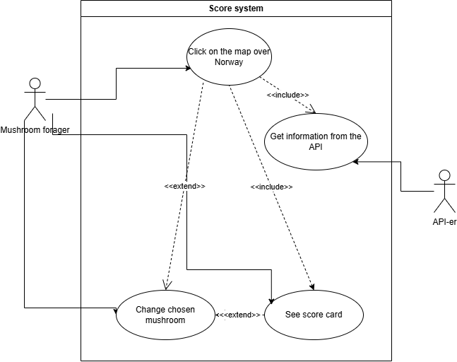

### Use case diagram 2  

  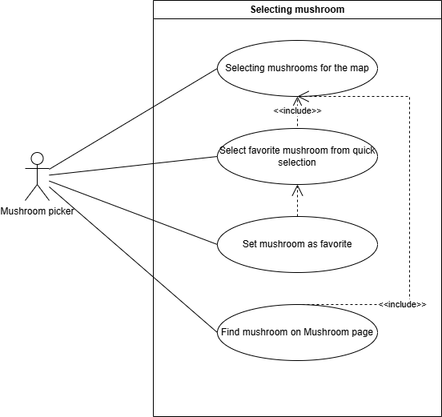

### Use case diagram 3  

  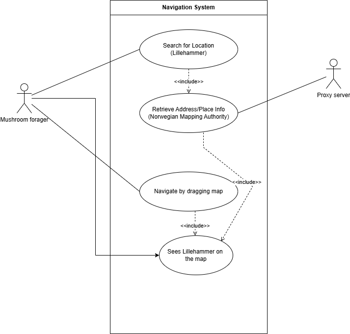

___
## Sequence diagrams  

### Sequence diagram 1  

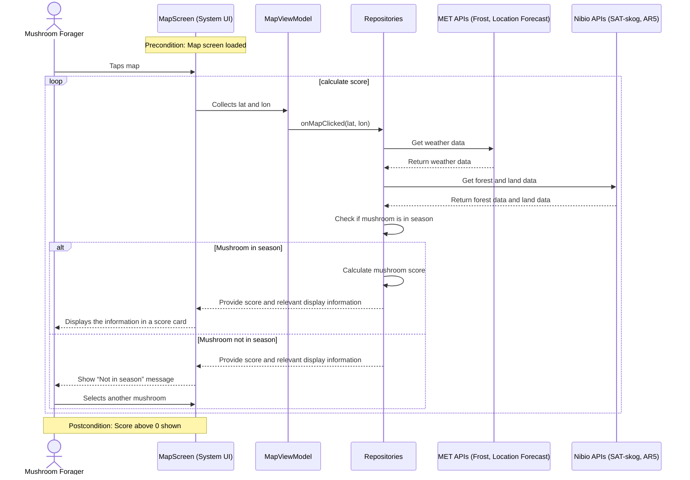

### Sequence diagram 2  

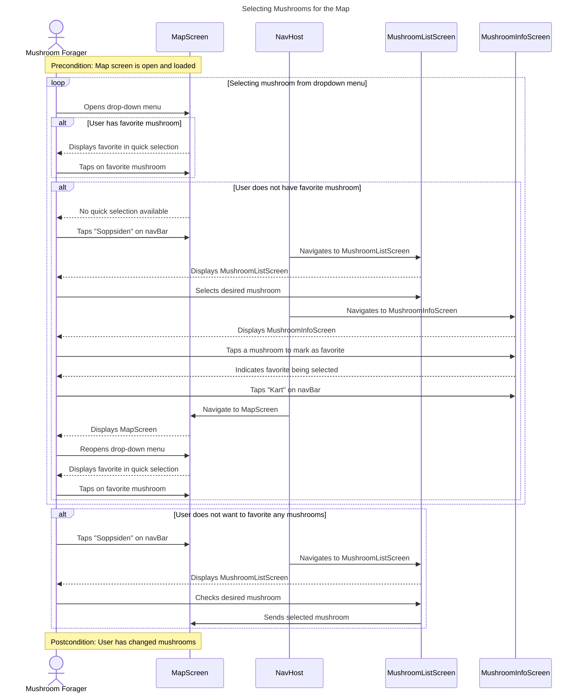

### Sequence diagram 3  

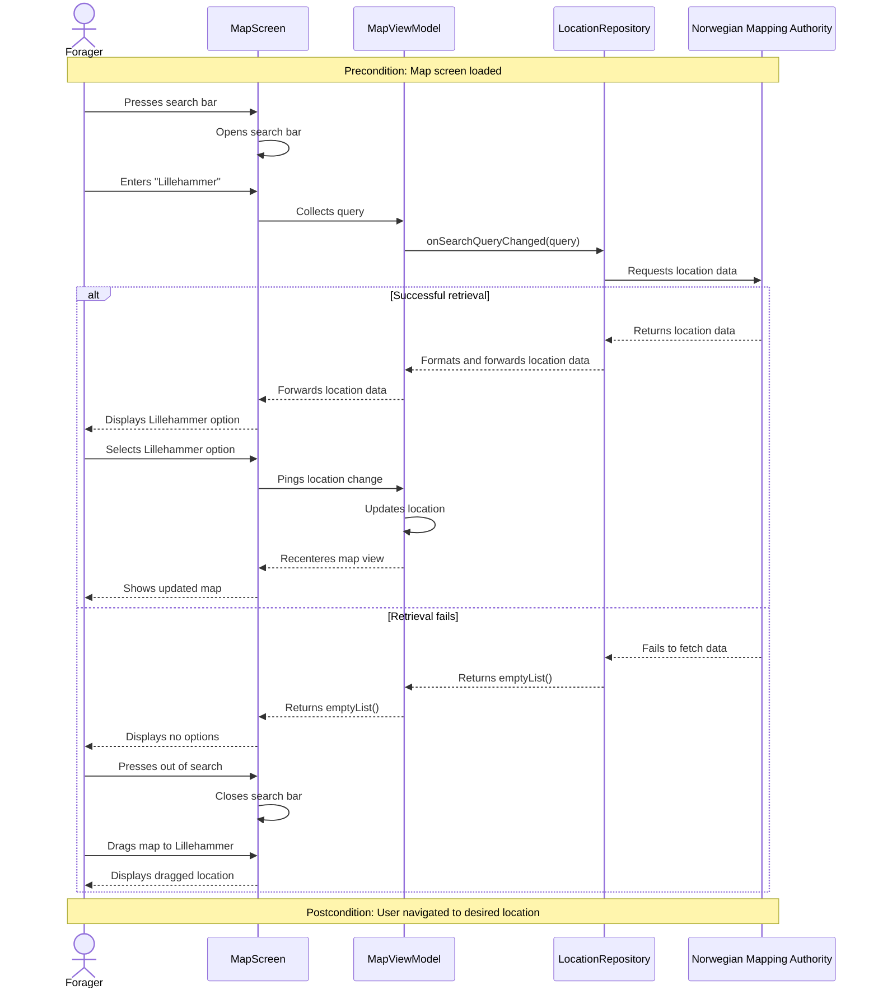
___
## Class diagram

### Class diagram 1
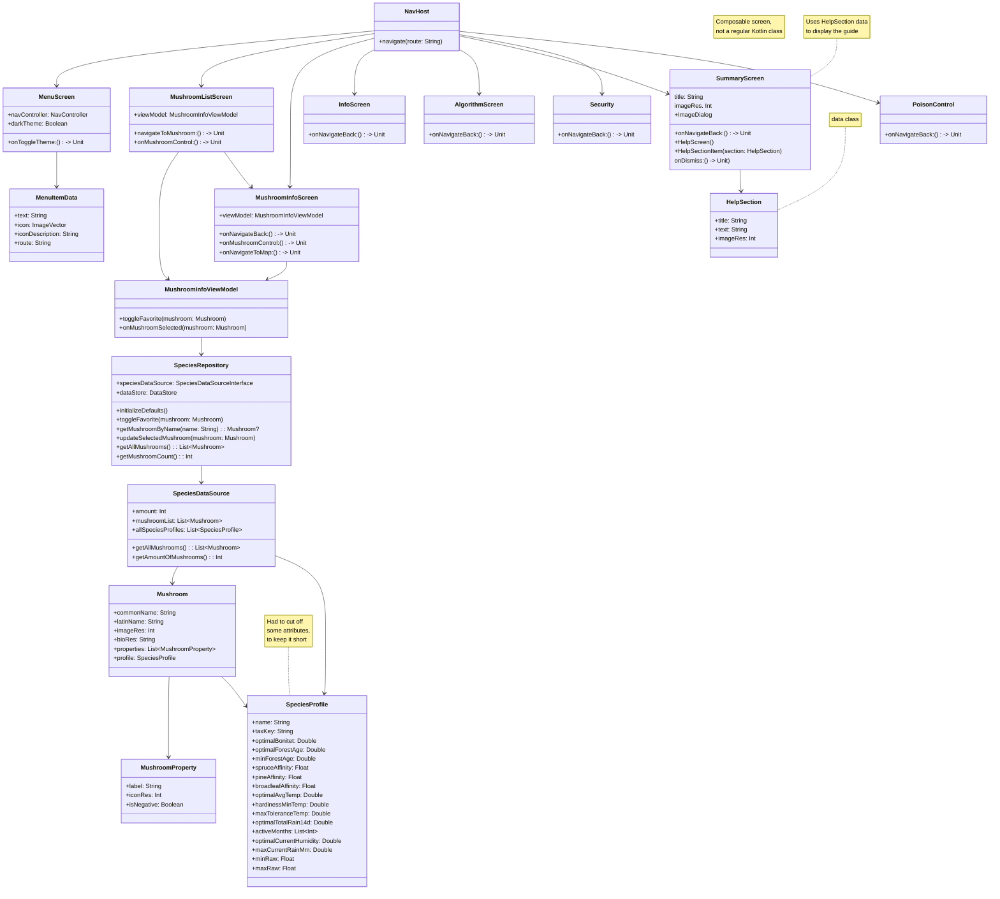

### Class diagram 2

```mermaid
classDiagram
direction TB
    class MapViewModel {
        +speciesRepository: SpeciesRepositoryInterface
        +locationRepository: LocationRepositoryInterface
        +getEnvironmentContextUseCase: GetEnvironmentContextUseCase
        +calculateHeatmapAreaUseCase: CalculateHeatmapAreaUseCase
        +scorerProvider: ScorerProvider
        +onMapClicked(lat: Double, lon: Double)
        +fetchHeatmapData(bounds: BoundingBox)
        +toggleHeatmap()
        +onMushroomSelected(mushroom: Mushroom)
        +onSearchQueryChanged(query: String)
        +searchAddressByText(query: String)
        +searchLocation(location: SearchableLocation)
        +centerOnUser()
        +onCameraMoved()
        +onCameraIdle(target: LatLng?, zoom: Double, visibleBounds: BoundingBox)
        +onUserLocationUpdated(lat: Double, lon: Double)
        +onPendingCameraTargetConsumed()
        +toggleSatellite()
        +toggleWmsForest()
        +toggleHistoricalFinds()
        +dismissEvaluation()
        +refreshCurrentLocation()
        setSearchBarExpanded(expanded: Boolean)
    }


    class GetEnvironmentContextUseCase {
        +locationForecastRepository: LocationForecastRepositoryInterface
        +mushroomRepository: MushroomRepositoryInterface
        +forestRepository: SatSkogRepositoryInterface
        +frostRepository: FrostRepositoryInterface
        +ar5Repository: ForestRepositoryInterface
        +invoke(lat: Double, lon: Doubleprofile: SpeciesProfile? = null) : EnvironmentContext
    }


    class CalculateHeatmapAreaUseCase {
        +locationForecastRepository: LocationForecastRepositoryInterface
        +mushroomRepository: MushroomRepositoryInterface
        +forestRepository: SatSkogRepositoryInterface
        +frostRepository: FrostRepositoryInterface
        +scorerProvider: ScorerProvider
        +invoke(bounds: BoundingBox, profile: SpeciesProfile,
        ): List
        existingTiles: List = emptyList()
        +getStepSize(mapHeight: Double) : Double
        +generateGridPoints(bounds: BoundingBox, step: Double) : List
        +calculateDistance(lat1: Double, lon1: Double, lat2: Double, lon2: Double) : Double
    }


    class FrostRepository {
        +weatherHistory(lat: Double, lon: Double) : WeatherHistory?
    }


    class LocationForecastRepository {
        +weatherNext8Hours(lat: Double, lon: Double) : WeatherData?
        +roundToTwoDecimals(value: Double) : Double
    }


    class SatSkogRepository {
        +fetchAndMapForestData(lat: Double, lon: Double) : ForestData?
        +getForestData(lat: Double, lon: Double) : ForestData?
        +getForestDataForHeatmap(lat: Double, lon: Double) : ForestData?
    }


    class ScoreProvider {
        +getScorer() : MushroomScorer
    }


    class MushroomScorer {
        +calculateScore(context: EnvironmentContext, species: SpeciesProfile) : EvaluationResult
    }


    class EnvironmentContext {
        +weatherHistory: WeatherHistory?
        +weatherData: WeatherData?
        +forestData: ForestData?
    }


    class EvaluationResult {
        +score: Int
        +description: String
        +isInSeason: Boolean
    }


    class SpeciesProfile {
        +name: String
        +taxKey: String
        +optimalBonitet: Double
        +optimalForestAge: Double
        +minForestAge: Double
        +spruceAffinity: Float
        +pineAffinity: Float
        +broadleafAffinity: Float
        +optimalAvgTemp: Double
        +hardinessMinTemp: Double
        +maxToleranceTemp: Double
        +optimalTotalRain14d: Double
        +activeMonths: List~Int~
        +optimalCurrentHumidity: Double
        +maxCurrentRainMm: Double
        +minRaw: Float
        +maxRaw: Float
    }


    class WeatherHistory {
        +avgTempPast14Days: Double?
        +totalRainPast14Days: Double?
        +minTempPast14Days: Double?
        +maxTempPast14Days: Double?
    }


    class WeatherData {
        +temperature: Double
        +precipitation: Double
        +windSpeed: Double
    }


    class ForestData {
        +forestType: String
        +bonitet: String
    }


    class BoundingBox {
        +north: Double
        +south: Double
        +east: Double
        +west: Double
    }


    class HeatmapTile {
        +score: Int
        +bounds: BoundingBox
    }


    class SearchableLocation {
        +name: String
        +lat: Double
        +lon: Double
    }


    class LocationRepository {
        +placeDataSource: PlaceDataSourceInterface
        +addressDataSource: AddressDataSourceInterface
        +search(query: String) : List~SearchableLocation~
        +getLocationCoordinates(query: String) : SearchableLocation?
    }


    class AiAlgorithm {
        -aiRepository: AiService
        +calculateScore(context: EnvironmentContext, species: SpeciesProfile) EvaluationResult
    }


    class BasicAlgorithm {
        +calculateScore(context: EnvironmentContext, species: SpeciesProfile) EvaluationResult
        -buildDescription(forest: Double, history: Double, current: Double) String
    }


    class AiService {
        +getAiScore(prompt: String) EvaluationResult
    }


    class MlAlgorithm {
        -contextApp: Context
        +calculateScore(context: EnvironmentContext, species: SpeciesProfile) EvaluationResult
        -buildDescription(ml: Double, current: Double) String
    }


    <<interface>> MushroomScorer
    <<Interface>> AiService


    MapViewModel --> GetEnvironmentContextUseCase
    MapViewModel --> CalculateHeatmapAreaUseCase
    MapViewModel --> LocationRepository
    MapViewModel --> ScoreProvider
    MapViewModel --> EvaluationResult
    MapViewModel --> SpeciesProfile
    MapViewModel --> BoundingBox
    MapViewModel --> SearchableLocation
    GetEnvironmentContextUseCase --> FrostRepository
    GetEnvironmentContextUseCase --> LocationForecastRepository
    GetEnvironmentContextUseCase --> SatSkogRepository
    GetEnvironmentContextUseCase --> EnvironmentContext
    FrostRepository --> WeatherHistory
    LocationForecastRepository --> WeatherData
    SatSkogRepository --> ForestData
    EnvironmentContext --> WeatherHistory
    EnvironmentContext --> WeatherData
    EnvironmentContext --> ForestData
    ScoreProvider --> MushroomScorer
    MushroomScorer --> EnvironmentContext
    MushroomScorer --> SpeciesProfile
    MushroomScorer --> EvaluationResult
    AiAlgorithm ..|> MushroomScorer
    AiAlgorithm ..|> AiService
    AiAlgorithm --> EnvironmentContext
    AiAlgorithm --> SpeciesProfile
    AiAlgorithm --> EvaluationResult
    BasicAlgorithm ..|> MushroomScorer
    BasicAlgorithm --> EnvironmentContext
    BasicAlgorithm --> SpeciesProfile
    BasicAlgorithm --> EvaluationResult
    MlAlgorithm ..|> MushroomScorer
    MlAlgorithm --> EnvironmentContext
    MlAlgorithm --> SpeciesProfile
    MlAlgorithm --> EvaluationResult
    CalculateHeatmapAreaUseCase --> BoundingBox
    CalculateHeatmapAreaUseCase --> HeatmapTile
    HeatmapTile --> BoundingBox
    LocationRepository --> SearchableLocation
    SatSkogRepository --> ForestData

```

___
## Activity diagrams  

### Activity diagram 1  

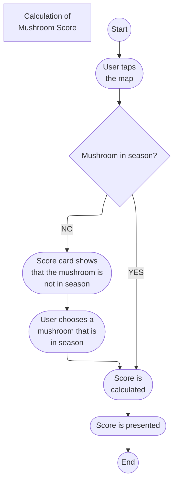

### Activity diagram 2   

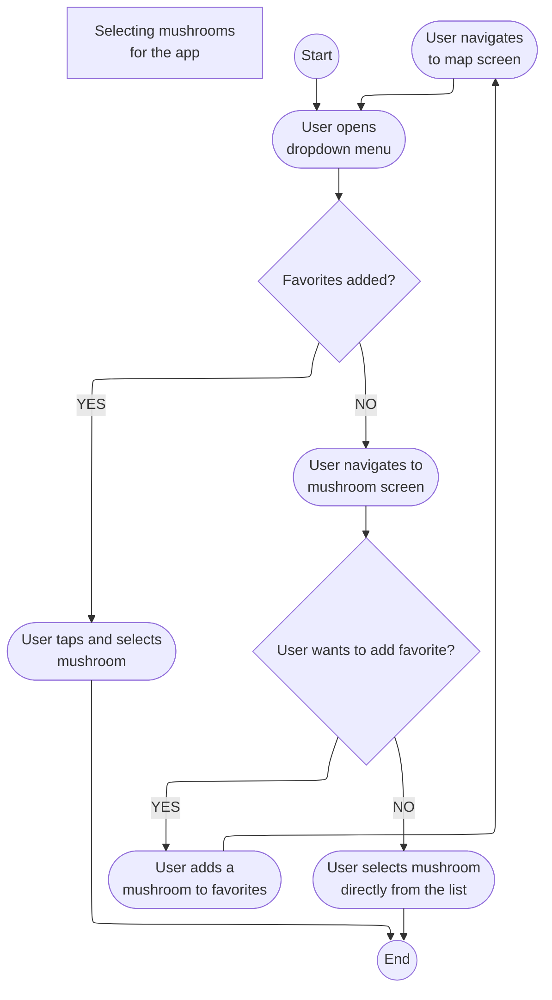

### Activity diagram 3   

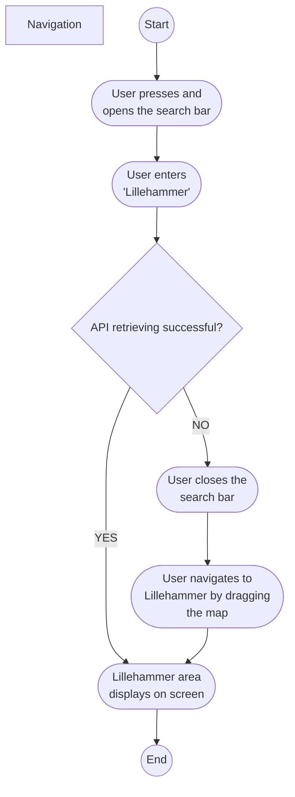

___
## Statediagram

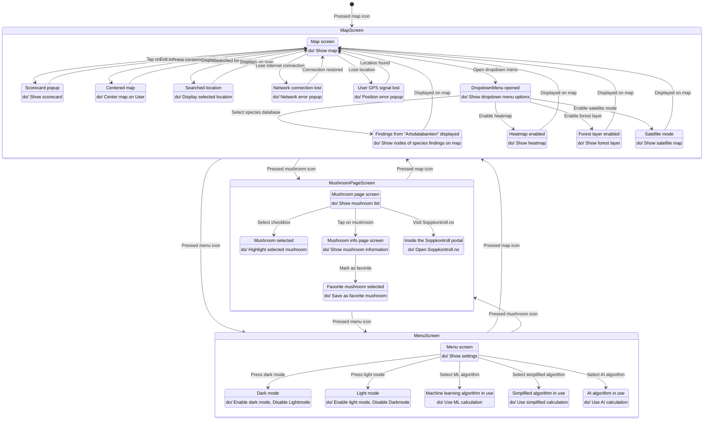

